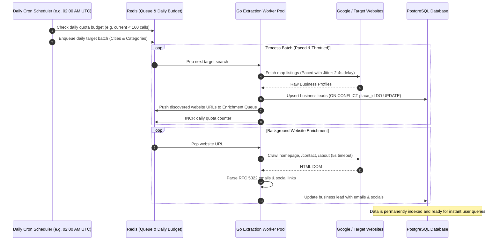

# Daily Batch Ingestion & Local Storage Architecture

## 1. Concept: "Ingest to Own DB, Query Locally"

Instead of triggering live external requests to Google on every user dashboard interaction or search query, the system operates on an **asynchronous batch ingestion model**:

```
┌─────────────────────────────────────────────────────────────────────────────────────────┐
│                                 DAILY BATCH INGESTION                                  │
│                                                                                         │
│  [ Scheduled Cron / Daily Dispatcher ]                                                  │
│                    │                                                                    │
│                    ▼                                                                    │
│        [ Redis Task Queue & Daily Quota Guard ]  ◄── Enforces Free Tier / Anti-Bot Rate │
│                    │                                                                    │
│                    ▼                                                                    │
│        [ Worker Pool (Scraper / API + Contact Crawler) ]                                │
│                    │                                                                    │
│                    ▼                                                                    │
│        [ PostgreSQL Lead Lake ] (ON CONFLICT DO UPDATE)                                 │
└────────────────────┬────────────────────────────────────────────────────────────────────┘
                     │
                     ▼ (Instant < 10ms queries, Zero Google traffic)
┌─────────────────────────────────────────────────────────────────────────────────────────┐
│                              DASHBOARD & USER WORKFLOW                                  │
│                                                                                         │
│  [ Svelte 5 Dashboard ] ──► [ Go API ] ──► [ PostgreSQL ] (Search, Filter, CSV Export) │
└─────────────────────────────────────────────────────────────────────────────────────────┘
```

---

## 2. Why This Strategy is Superior for Lead Generation

| Metric | Live Polling Model (Anti-pattern) | Local DB Batch Ingestion Model (Our Design) |
| :--- | :--- | :--- |
| **Dashboard Query Speed** | 3 – 8 seconds (waiting on external HTTP) | **< 10 milliseconds** (indexed PostgreSQL query) |
| **Google API Cost / Free Tier** | Unpredictable, risks sudden overage bills | **100% Guaranteed Free**: Hard cap at 160 calls/day (4,800/mo) |
| **Bot Detection / IP Ban Risk** | High (bursty traffic triggers Google CAPTCHAs) | **Near Zero**: Gentle, randomized pacing (1 req / 2–5s) off-peak |
| **Email & Social Enrichment** | Impossible in real-time without blocking UI | **Seamless**: Background workers crawl websites asynchronously |
| **Data Ownership & History** | Ephemeral, lost when session closes | **Permanent proprietary lead database**, filterable anytime |
| **Offline / Resilient Operation** | Fails if Google rate-limits or network drops | **Always available**: Dashboard reads from local Postgres |

---

## 3. Storage Layer Roles: PostgreSQL & Redis

### 3.1. Redis Role: Queue, Rate Budget, and Deduplication
1. **Daily Quota Budgeting (`bizscrape:quota:daily:<YYYY-MM-DD>`)**:
   - Atomic Redis counter (`INCR`) with 24-hour TTL.
   - If configured to use Google Places API, the system automatically stops ingestion when the daily budget (e.g. 160 calls/day) is reached to guarantee **zero overage charges**.
2. **Deduplication Set (`bizscrape:seen:places`)**:
   - Tracks already scraped `place_id` hashes to prevent redundant website crawling or duplicate network traffic.
3. **Asynchronous Job Queues**:
   - `bizscrape:queue:scrape` — List of target keywords/locations waiting to be extracted.
   - `bizscrape:queue:enrich` — List of discovered website URLs waiting for email/social parsing.
4. **Single-User Session Store**:
   - `bizscrape:session:<token>` — Fast 24-hour admin session management.

### 3.2. PostgreSQL Role: Permanent Relational Lead Lake
- **Table `business_leads`**:
  - Indexed by `category`, `city`, `state`, `rating`, `review_count`, and `created_at`.
  - GIN indexes on `emails` (JSONB) and `subcategories` (JSONB) for instant boolean filtering (`has_email = true`, category search).
  - Upsert mechanism: `ON CONFLICT (place_id) DO UPDATE` updates review count, rating, and hours without duplicating records.
- **Table `scrape_jobs`**:
  - Records batch run logs, daily throughput, enriched lead counters, and error summaries.

---

## 4. Daily Execution Flow & Scheduling Mechanics



---

## 5. Dual Execution Trigger Options in the Dashboard
1. **Scheduled Daily Ingestion (Automated)**:
   - Configurable schedule (e.g., daily at 02:00 AM) that systematically extracts leads for your priority cities/niches.
2. **On-Demand Immediate Ingestion (Manual)**:
   - The user can click `+ New Scrape Job` in the dashboard to immediately ingest a new keyword/city.
   - Results stream into PostgreSQL and appear in real-time on the data table.
