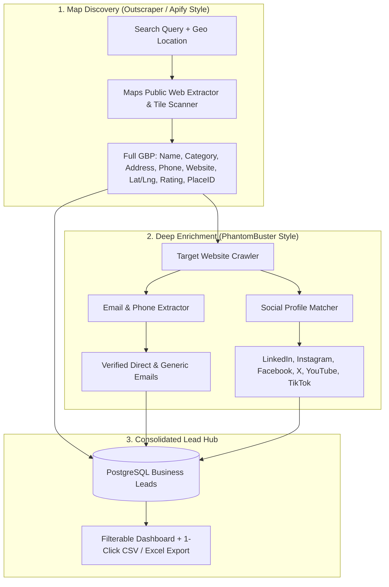
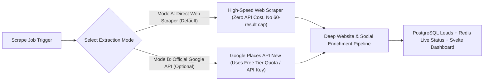

# Google Maps API Deep-Dive & Scraping Strategy Analysis

## 1. Executive Summary

This document provides a comprehensive technical analysis of the **Google Maps Platform (Places API New)** versus **Specialized Web Scraping (Outscraper / Apify / PhantomBuster methodologies)** for extracting business listings and contact leads in bulk.

It covers:
1. Google Places API (New) architecture, endpoints, and field masking.
2. Pricing structure, per-SKU free tier allowances, and cost projections.
3. Critical API limitations (no emails, 60-result search caps, ToS restrictions).
4. Web scraping & contact enrichment mechanics (Outscraper / PhantomBuster approach).
5. The dual-engine architecture designed for this service.

---

## 2. Official Google Places API (New) Architecture

Google recently modernized the Places API with the **Places API (New)**, which replaces the legacy Places API with RESTful POST endpoints and mandatory field masking.

### 2.1. Key API Endpoints
- **Text Search (New)**: `POST https://places.googleapis.com/v1/places:searchText`
  - Searches for businesses based on query string and location bias/restriction (e.g., "coffee shops in Austin TX").
  - Returns up to **20 results per request**, with a pagination token up to a maximum of **60 results total** per query.
- **Nearby Search (New)**: `POST https://places.googleapis.com/v1/places:searchNearby`
  - Searches within a specific circle radius or bounding box.
- **Place Details (New)**: `GET https://places.googleapis.com/v1/places/{placeId}`
  - Fetches deep details for a single place given its Google `placeId`.

### 2.2. Mandatory Field Masks (`X-Goog-FieldMask`)
In the Places API (New), requests **must** include the `X-Goog-FieldMask` HTTP header specifying the exact fields requested. 

```http
POST https://places.googleapis.com/v1/places:searchText
Host: places.googleapis.com
Content-Type: application/json
X-Goog-Api-Key: AIzaSy...
X-Goog-FieldMask: places.id,places.displayName,places.formattedAddress,places.websiteUri,places.nationalPhoneNumber,places.rating,places.userRatingCount

{
  "textQuery": "Dentists in Miami, FL",
  "pageSize": 20
}
```

---

## 3. Google API Pricing, SKUs & Free Tier Allowances

Google Maps Platform transitioned from a generic $200 universal credit to **per-SKU monthly free allowances**.

### 3.1. SKU Tiers & Billing Rules
Billing is determined by the **highest-tier field** included in your `X-Goog-FieldMask`:

| SKU Tier | Included Fields | Monthly Free Usage | Overage Cost (per 1,000 calls) |
| :--- | :--- | :--- | :--- |
| **Essentials (Basic)** | `id`, `displayName`, `formattedAddress`, `location` (lat/lng), `types`, `addressComponents`, `plusCode`, `shortFormattedAddress` | **10,000 requests / month** | ~$5.00 |
| **Pro (Contact & Operations)** | `nationalPhoneNumber`, `internationalPhoneNumber`, `websiteUri`, `regularOpeningHours`, `currentOpeningHours`, `businessStatus`, `rating`, `userRatingCount`, `priceLevel` | **5,000 requests / month** | ~$17.00 – $25.00 |
| **Enterprise (Atmosphere & Media)** | `reviews`, `photos`, `editorialSummary`, `paymentOptions`, `parkingOptions`, `accessibilityOptions` | **1,000 requests / month** | ~$25.00 – $32.00 |

> [!WARNING]
> **Highest-Tier Billing Trap**: If you request `places.displayName` (Essentials) along with `places.websiteUri` (Pro) and `places.reviews` (Enterprise), the entire request is billed at the **Enterprise SKU rate**.

### 3.2. Cost Scaling Comparison

| Scraped Leads Goal | Using Google Places API (Pro Tier) | Using Our High-Speed Scraper |
| :--- | :--- | :--- |
| **1,000 Leads** | Free (Within 5,000 monthly free tier) | $0.00 |
| **10,000 Leads** | ~$125 – $170 USD | $0.00 (Minimal proxy bandwidth) |
| **50,000 Leads** | ~$850 – $1,250 USD | $0.00 |
| **500,000 Leads** | ~$8,500 – $12,500 USD | ~$15 – $30 (Proxy bandwidth only) |

---

## 4. Fundamental Limitations of Google Places API for Lead Generation

### 1. Zero Direct Email Data
- Google Places API **does not store or provide business email addresses** under any SKU or subscription tier.
- Relying exclusively on Google APIs results in zero email leads.

### 2. The 60-Result Query Cap
- A single Google Places query caps results at 60 (3 pages of 20).
- To extract 2,000 real estate agents in a metro area, an API-based system must mathematically slice the city into dozens of micro-coordinates (bounding box tessellation), multiplying API calls and costs.

### 3. Google Terms of Service (ToS) Constraints
- Section 3.2.3 of the Google Maps Platform Terms strictly limits long-term caching and mass local storage of Google Maps content (except `place_id`).
- Reselling or creating standalone lead databases from Google API data is prohibited by their terms.

---

## 5. How Outscraper, Apify & PhantomBuster Solve This



### 5.1. The Scraping Mechanics
1. **Google Maps Web RPC / Tile Scanning**:
   - Outscraper and Apify extract publicly accessible listing details rendered on Google Maps without an API key.
   - They navigate search grids, extracting hundreds of listings per area with full details.
2. **Post-Extraction Deep Contact Crawling (PhantomBuster)**:
   - Given the business `website` obtained in Step 1:
   - Crawler fetches the homepage, `/contact`, `/about-us`, `/team`, and `/privacy-policy`.
   - Extracts:
     - `mailto:` links and RFC 5322 regex email addresses.
     - Secondary mobile / office phone numbers.
     - Direct profile links for LinkedIn (company & executive), Instagram, Facebook, X (Twitter), YouTube, and TikTok.

---

## 6. The Dual-Engine Architecture Implemented in Our Service

Our Go backend is engineered to support **both modes seamlessly**:



### 6.1. Mode A: High-Speed Web Scraper (Default & Recommended)
- **Zero API Key Requirement**: Completely self-contained.
- **No 60-Result Cap**: Extracts all available businesses in any region or keyword.
- **Smart Proxy Rotation**: Built-in HTTP/SOCKS5 proxy rotator for high-volume jobs.

### 6.2. Mode B: Official Google Places API (New) Engine
- **Configurable in Settings**: Enter a Google Maps API Key in `.env` or settings.
- **Cost-Optimized Field Masks**: Uses granular field masks (`places.id`, `places.displayName`, `places.formattedAddress`, `places.websiteUri`, `places.nationalPhoneNumber`, `places.rating`) to stay strictly within the **free monthly quota**.
- **Automatic Fallback**: If quota is exceeded, seamlessly switches to Mode A or alerts the user.

### 6.3. Deep Contact Enrichment Pipeline (Common to Both)
- Crawls extracted business websites concurrently with a 5-second timeout and 2MB buffer safety limit.
- Deduplicates and cleans emails (filters dummy/sentry/wix emails).
- Extracts LinkedIn, Instagram, Facebook, X, YouTube, and TikTok channels.
- Persists all data to PostgreSQL with live SSE/WebSocket progress updates to the Svelte 5 frontend.
