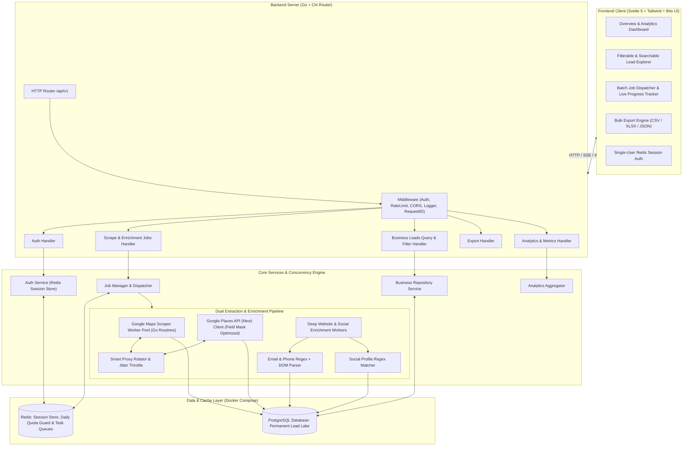
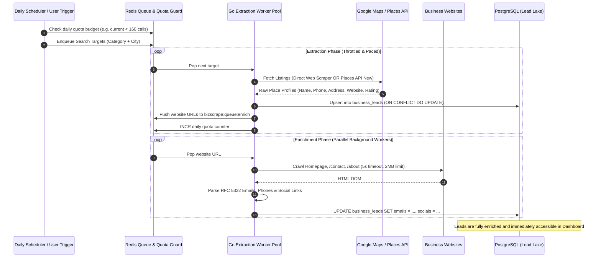
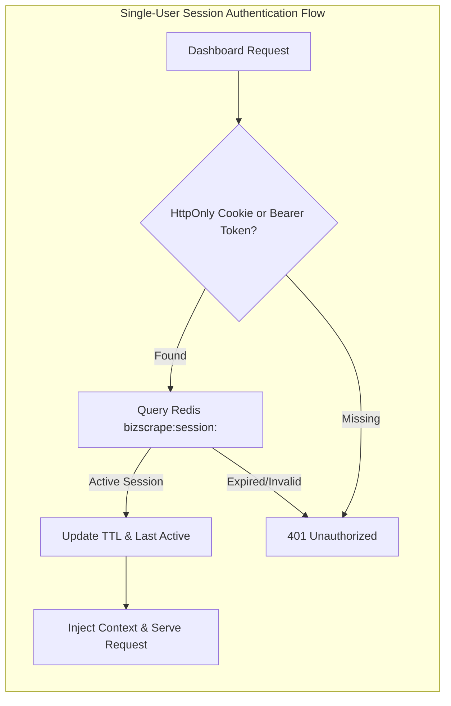

# Service Architecture: High-Speed Google Maps Extraction & Lead Enrichment Platform

## 1. Executive Summary & Objective

The **Business Scraping Service** is a high-throughput, self-hosted data extraction and lead enrichment platform engineered to pull thousands of Google Maps business profiles into structured datasets and spreadsheets within minutes.

The service implements an **"Ingest to Own DB, Query Locally"** architectural philosophy:
- **Asynchronous Daily Batch & On-Demand Ingestion**: Extraction jobs pull business listings in a disciplined, rate-paced manner and enrich them with emails, phone numbers, and social channels (LinkedIn, Instagram, Facebook, X, YouTube, TikTok) before permanently saving them into our **PostgreSQL lead lake**.
- **Instant Sub-10ms Local Queries**: The **Svelte 5 dashboard** queries and filters directly against PostgreSQL (with GIN indexes on emails and subcategories), guaranteeing instant search, live filtering, and 1-click CSV/JSON downloads without external network delays or live Google API costs.
- **Single-User Security**: Authentication is managed by a high-performance **Redis session store** using HttpOnly cookies and Bearer tokens, mirroring the proven conventions of `paradapp/paradapp-admin-dashboard`.

---

## 2. High-Level System Architecture



---

## 3. Storage Layer Specifications: PostgreSQL & Redis

### 3.1. Redis Architecture (Port `6380`)
Redis handles volatile, high-speed state, task queuing, rate budgeting, and authentication:

| Key / Data Structure | Type | Purpose | TTL |
| :--- | :--- | :--- | :--- |
| `bizscrape:session:<token>` | `String (JSON)` | Active admin session payload (`admin_id`, `username`, `email`) | 24 Hours |
| `bizscrape:user_sessions:<admin_id>` | `Set (Tokens)` | Tracks active tokens per user for global logout / revocation | 7 Days |
| `bizscrape:quota:daily:<YYYY-MM-DD>` | `Integer (INCR)`| Atomic daily external API counter. Enforces free tier limit (e.g. max 160 calls/day) | 24 Hours |
| `bizscrape:seen:places` | `Set (Place IDs)`| Deduplication index to prevent duplicate scraping & website crawls | Persistent |
| `bizscrape:queue:scrape` | `List (FIFO)` | Scrape target queue (cities & categories) for batch worker pool | Ephemeral |
| `bizscrape:queue:enrich` | `List (FIFO)` | Discovered websites awaiting email & social enrichment | Ephemeral |

### 3.2. PostgreSQL Architecture (Port `5434`)
PostgreSQL functions as the permanent, indexed lead lake:
- **`business_leads` Table**:
  - `place_id` (Unique constraint) — Enables `ON CONFLICT (place_id) DO UPDATE` to refresh reviews/ratings without duplication.
  - `emails` (`JSONB`) & `subcategories` (`JSONB`) — Indexed via **GIN (Generalized Inverted Index)** for instant boolean filtering (`jsonb_array_length(emails) > 0`).
  - B-tree composite indexes on `(city, category, rating, claimed)` for sub-10ms table pagination.
- **`scrape_jobs` Table**:
  - Historical audit log of all batch runs, scraped volume, enriched counters, runtime durations, and error logs.
- **`admin_users` Table**:
  - Single-user admin credentials hashed with Bcrypt (cost 12).

---

## 4. Dual-Engine Extraction & Enrichment Pipeline



### 4.1. Extraction Modes Supported
1. **Mode A: High-Speed Web Scraper (Default / Outscraper Style)**:
   - Directly extracts publicly rendered Google Maps profiles.
   - Zero Google Cloud cost, zero API keys required, no 60-result pagination limit.
   - Integrated with proxy rotator & user-agent pool.
2. **Mode B: Official Google Places API New (Field Mask Optimized)**:
   - Utilizes `POST https://places.googleapis.com/v1/places:searchText` with `X-Goog-Api-Key` header.
   - Configured with optimal field mask to pull all business attributes in a single request (1 Pro SKU per 20 places).
   - Redis daily quota guard caps requests at 160 calls/day to guarantee **100% free usage** within Google's 5,000 monthly Pro tier allowance.

### 4.2. Deep Contact Enrichment Worker (PhantomBuster Style)
- **Website Crawler**: Visits `website`, `/contact`, `/about-us`, `/team` with strict 5-second timeouts and domain rate limiting.
- **Email Parser**: Extracts `mailto:` links, obfuscated emails, and RFC 5322 regex matches while filtering dummy domains (`example.com`, `sentry.io`, `wixpress.com`).
- **Social Extractor**: Extracts direct verified profiles for LinkedIn (company/individual), Instagram, Facebook, X (Twitter), YouTube, and TikTok.

---

## 5. Security & Single-User Authentication Architecture

Following the design established in `paradapp/paradapp-admin-dashboard`:



### 5.1. Authentication Specifications
- **Single-User Admin Model**: Super Admin credentials configured via `.env` (`SUPERADMIN_EMAIL`, `SUPERADMIN_USERNAME`, `SUPERADMIN_PASSWORD`) with automatic database bootstrapping on first startup.
- **Password Security**: Bcrypt hash with work factor 12.
- **Session Tokens**: Cryptographically secure 32-byte hex tokens stored in Redis with 24-hour sliding TTL.
- **Transport**: `HttpOnly`, `SameSite=Lax`, `Secure` cookies with fallback `Authorization: Bearer <token>` support.
- **Observability**: Request ID tracing (`X-Request-ID`) on every response and structured `slog` output.

---

## 6. RESTful API Specification (`/api/v1`)

### 6.1. Authentication Routes
- `POST /api/v1/auth/login` — Authenticate admin, set session cookie.
- `GET  /api/v1/auth/me` — Validate session and fetch current admin profile.
- `POST /api/v1/auth/logout` — Revoke Redis session and clear cookie.
- `POST /api/v1/auth/change-password` — Change admin password.

### 6.2. Batch & On-Demand Scraping Jobs Routes
- `POST /api/v1/jobs` — Create and trigger an extraction job (supports query, location, category, max results, enrichment toggle, engine mode).
- `GET  /api/v1/jobs` — Paginated job list with execution status and throughput.
- `GET  /api/v1/jobs/{id}` — Real-time progress details (items found, enriched, errors).
- `POST /api/v1/jobs/{id}/cancel` — Cancel an active job.

### 6.3. Business Leads Query & Filtering Routes
- `GET  /api/v1/businesses` — Sub-10ms search and filter across PostgreSQL lead lake.
  - Query Parameters: `search`, `category`, `city`, `state`, `has_email` (bool), `has_phone` (bool), `min_rating`, `claimed` (bool), `sort_by`, `sort_order`, `page`, `page_size`.
- `GET  /api/v1/businesses/{id}` — Full profile details with raw emails, phone numbers, and social links.
- `DELETE /api/v1/businesses/{id}` — Delete a lead record.
- `POST /api/v1/businesses/{id}/enrich` — Manually trigger deep re-enrichment for a single lead.

### 6.4. Bulk Export Routes
- `GET  /api/v1/export/csv` — Stream high-speed CSV with custom column selection.
- `GET  /api/v1/export/xlsx` — Generate formatted Excel workbook.
- `GET  /api/v1/export/json` — Stream structured JSON lead array.

### 6.5. Analytics & System Health Routes
- `GET  /api/v1/metrics/overview` — Total leads, enriched leads count, email hit rate (%), phone reach (%), active jobs, daily quota remaining.
- `GET  /api/v1/metrics/category-distribution` — Top 10 business categories breakdown.
- `GET  /api/v1/metrics/location-distribution` — Top geographic clusters breakdown.
- `GET  /api/v1/system/health` — DB pool status, Redis latency, active scraper worker goroutines.

---

## 7. Frontend Dashboard & UI Specification (Svelte 5)

```
┌────────────────────────────────────────────────────────────────────────────────────────┐
│  [Logo] BizScrape Pro        [🔍 Search Leads / Jobs...]            [Admin (Online) ▼] │
├──────────────┬─────────────────────────────────────────────────────────────────────────┤
│ 📊 Overview  │  [ Total Leads ]   [ Enriched Emails ]   [ Phone Reach ]  [ Daily Quota]│
│ 🏢 Leads DB  │     14,820              9,450 (63.7%)        13,210 (89%)     142/160   │
│ ⚡ Scrape Jobs│ ─────────────────────────────────────────────────────────────────────── │
│ 📥 Export Hub│  [ + New Scraping Job ]   [ 📥 Quick Export CSV ]   [ 🔄 Refresh Data ]  │
│ ⚙️ Settings   │ ─────────────────────────────────────────────────────────────────────── │
│              │  Filters: [Category: All ▼] [City: All ▼] [Has Email: ☑] [Rating: > 4.0]│
│              │ ┌─────────────────────────────────────────────────────────────────────┐ │
│              │ │ Business Name      │ Category    │ City      │ Rating │ Email/Social│ │
│              │ ├────────────────────┼─────────────┼───────────┼────────┼─────────────┤ │
│              │ │ Stumptown Coffee   │ Coffee Shop │ Seattle   │ ★ 4.7  │ ✉️ 🔗 📸 📘  │ │
│              │ │ Elm Coffee Roaster │ Coffee Shop │ Seattle   │ ★ 4.8  │ ✉️ 🔗 📸    │ │
│              │ │ Monorail Espresso  │ Coffee Shop │ Seattle   │ ★ 4.6  │ ✉️ 📞        │ │
│              │ └─────────────────────────────────────────────────────────────────────┘ │
│              │  Showing 1-20 of 14,820 leads        [ < Prev ] [ 1 ] [ 2 ] ... [ Next > ]│
└──────────────┴─────────────────────────────────────────────────────────────────────────┘
```

---

## 8. Local Tooling & Docker Strategy (`mise` + Docker)

### 8.1. `docker-compose.yaml` (Isolated Local Storage)
- **PostgreSQL 16 Alpine**: Exposed on port `5434:5432` with volume persistence.
- **Redis Alpine**: Exposed on port `6380:6379` with AOF persistence.

### 8.2. `mise.toml` Developer Workflow
- Automated tasks:
  - `mise run db-run-dev`: Starts PostgreSQL & Redis containers.
  - `mise run dev-backend`: Runs Go server in development mode.
  - `mise run dev-frontend`: Runs Svelte 5 frontend with Vite HMR.
  - `mise run dev`: Concurrently runs backend & frontend.
  - `mise run test`: Runs backend unit test suite and frontend typechecks.
